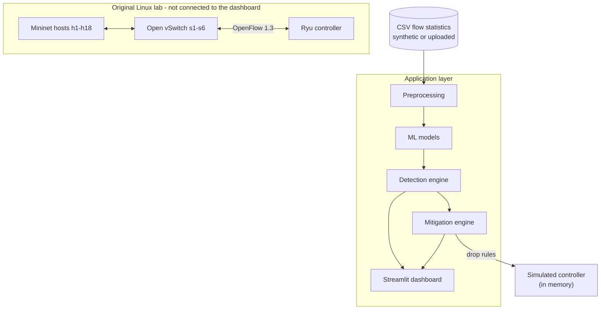
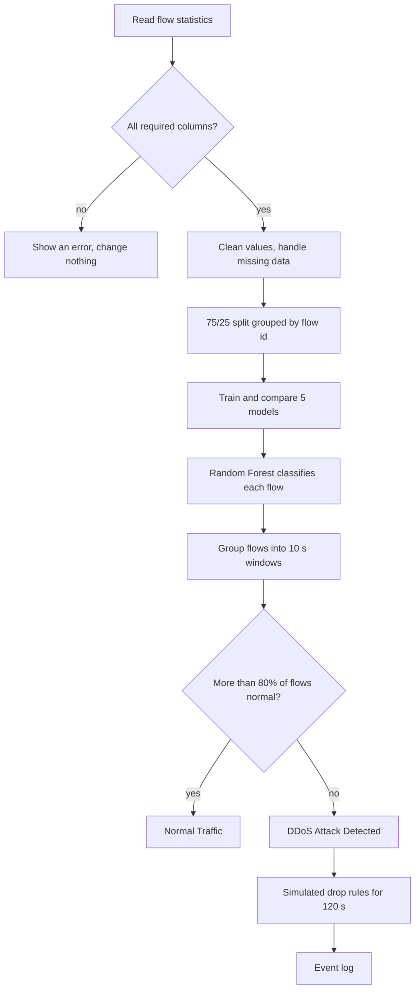
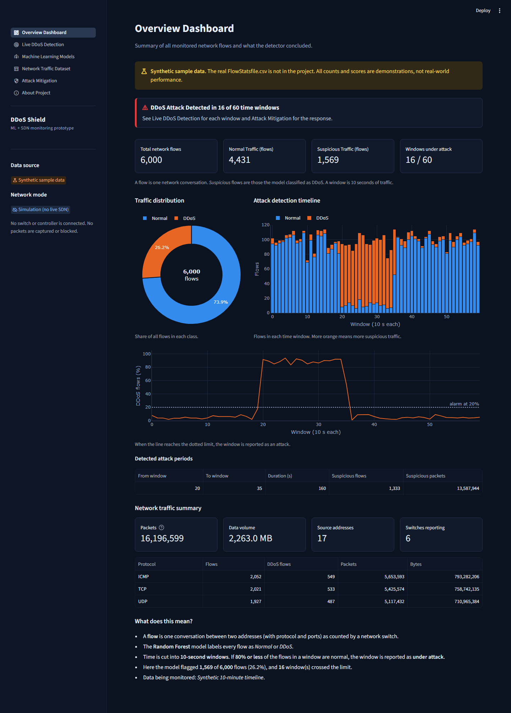
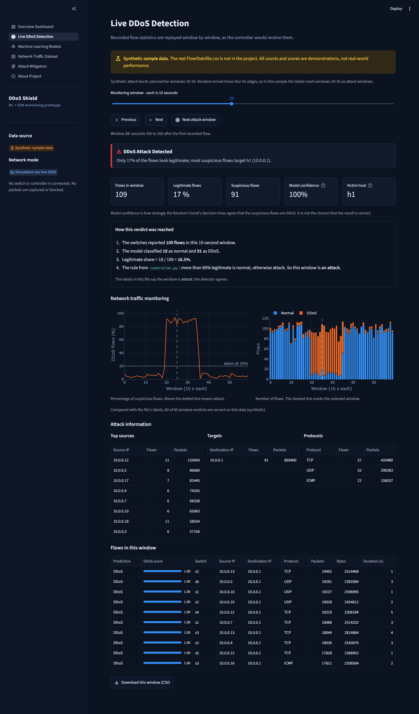
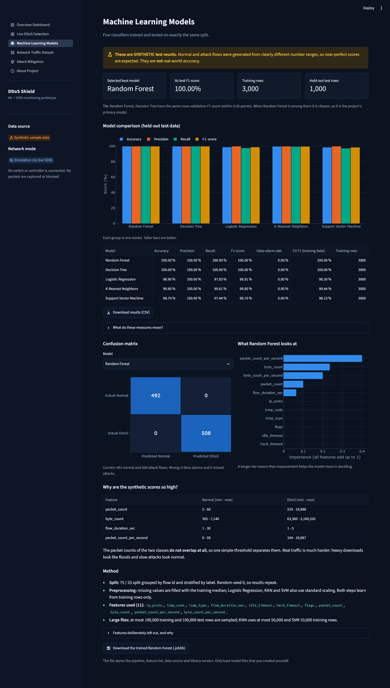
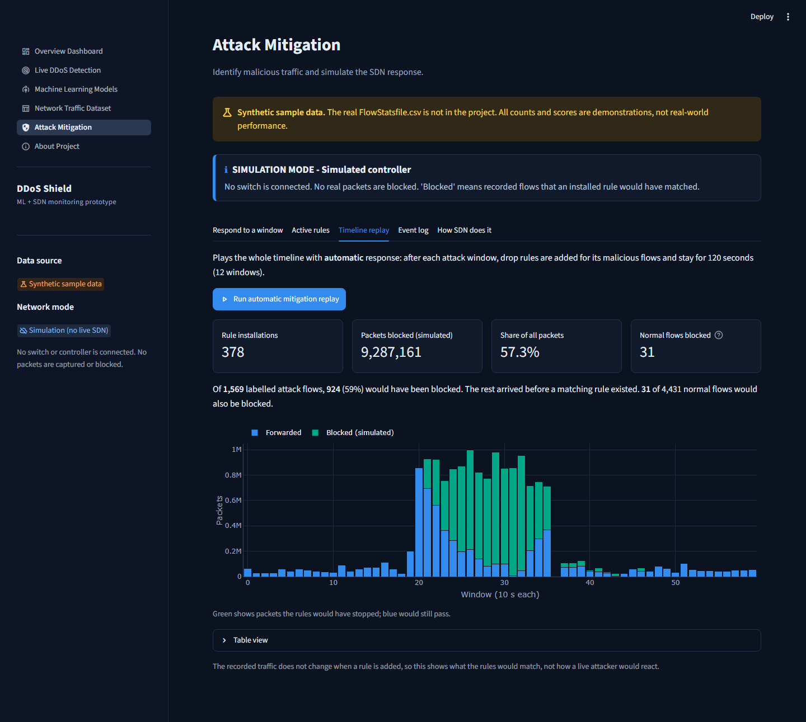

# Live DDoS Detection and Mitigation Using Machine Learning and Software-Defined Networking (SDN)

A final-year engineering prototype that classifies network **flow statistics** as normal or
**DDoS** traffic, raises an alarm for every **10-second window**, and **simulates** how an SDN
controller would block the attack. It has a Streamlit dashboard that runs on Windows.

> **Please read before quoting any result**
> - The sample data is **synthetic**. The real dataset is not included. Scores near 100 % are
>   **not** real-world detection accuracy.
> - Mitigation is **simulated**. No packet is captured or blocked.
> - "Live" means recorded traffic is replayed window by window. The dashboard does not capture
>   traffic from a network.
> - The Mininet / Ryu code is included but has **not** been run or verified in this prototype.

**Contents:** [Overview](#1-project-overview) · [Abstract](#2-abstract) ·
[Introduction](#3-introduction) · [Problem](#4-problem-statement) ·
[Objectives](#5-objectives) · [Technologies](#6-technologies-used) ·
[Architecture](#7-system-architecture) · [Workflow](#8-project-workflow) ·
[Algorithms](#9-machine-learning-algorithms) · [Detection](#10-ddos-detection-methodology) ·
[Dashboard](#11-dashboard-features) · [Mitigation](#12-mitigation-mechanism) ·
[Requirements](#13-installation-requirements) · [Setup](#14-step-by-step-setup) ·
[Run](#15-how-to-run-the-project) · [Dataset](#16-dataset-information) ·
[Screenshots](#17-screenshots) · [Structure](#18-project-structure) ·
[Limitations](#19-limitations) · [Future work](#20-future-enhancements) ·
[Conclusion](#21-conclusion) · [Author](#22-author)

---

## 1. Project overview

| Part | Status |
|---|---|
| Streamlit dashboard (six pages) | Working, tested on Windows |
| Detection engine and five ML models | Working, tested with synthetic data |
| CSV upload and validation | Working |
| Mitigation | Simulation only |
| Ryu controller and Mininet lab (`Codes/`) | Original Linux code, not verified here |

## 2. Abstract

A Distributed Denial of Service (DDoS) attack floods a target with traffic so that real users
cannot use it. Software-Defined Networking (SDN) gives a central controller a view of the whole
network. This project uses flow statistics of the kind an SDN controller collects and machine
learning to separate normal flows from attack flows. Five models are compared and Random Forest
performs the detection. When an attack is found, the system identifies the victim and sources
and creates temporary drop rules in a simulated controller.

## 3. Introduction

In a DDoS attack many machines send traffic to one target at the same time. Common floods are
ICMP (ping), UDP and TCP SYN floods. SDN separates the **control plane**, which makes decisions,
from the **data plane**, which forwards packets. Switches report traffic counters to the
controller and follow its rules through the **OpenFlow** protocol. This makes the controller a
natural place to detect attacks and to respond to them.

## 4. Problem statement

From the flow statistics of an SDN network:

1. decide whether each flow is normal or part of a DDoS attack,
2. raise an alarm quickly and identify the victim, and
3. propose a response that stops attack traffic while disturbing normal users as little as
   possible.

## 5. Objectives

- Prepare flow data without leaking the answer to the model.
- Train and compare five machine learning models.
- Detect attacks in 10-second windows.
- Simulate mitigation and keep an event log.
- Present everything in a beginner-friendly dashboard.
- Keep detection, mitigation and the controller separate, ready for a real SDN controller.

## 6. Technologies used

| Technology | Purpose |
|---|---|
| Python | Programming language |
| pandas, NumPy | Data handling |
| scikit-learn, joblib | Machine learning and saving models |
| Streamlit, Plotly | Dashboard and charts |
| Matplotlib | Charts of the original command-line ML scripts |
| Ryu, Mininet, Open vSwitch, hping3 | Original SDN lab (Linux only) |

## 7. System architecture



The dashboard works with CSV files and a simulated controller. The Linux lab has its own Ryu
applications in `Codes/controller`.

## 8. Project workflow



## 9. Machine learning algorithms

| Model | Idea |
|---|---|
| **Random Forest** (primary) | Many decision trees vote |
| Decision Tree | A sequence of yes/no questions |
| Logistic Regression | A weighted sum turned into a probability |
| K-Nearest Neighbors | Majority class of the 5 closest examples |
| Support Vector Machine | The boundary with the widest margin |

Evaluation uses accuracy, precision, recall, F1-score, false alarm rate, a confusion matrix and
3-fold cross-validation on the training data.

### Results on SYNTHETIC data (seed 0, 1,000 held-out flows)

| Model | Accuracy | Precision | Recall | F1-score |
|---|---|---|---|---|
| Random Forest | 100.00 % | 100.00 % | 100.00 % | 100.00 % |
| Decision Tree | 100.00 % | 100.00 % | 100.00 % | 100.00 % |
| K-Nearest Neighbors | 99.80 % | 100.00 % | 99.61 % | 99.80 % |
| Logistic Regression | 98.90 % | 100.00 % | 97.83 % | 98.91 % |
| Support Vector Machine | 98.70 % | 100.00 % | 97.44 % | 98.70 % |

> These numbers show only that the software works. In the synthetic data, normal flows have
> 5-60 packets and attack flows 520-19,988 packets, so the classes do not overlap. **This is
> not real-world accuracy.**

## 10. DDoS detection methodology

1. **Features (11):** protocol, ICMP code and type, duration, timeouts, flags, packet and byte
   counts, and packets and bytes per second.
2. **Left out:** time, switch id, flow id, IP addresses and ports (they would let the model
   memorise the lab setup) and the per-nanosecond columns (noise).
3. **No leakage:** all rows of one flow stay on one side of the train/test split; filling of
   missing values and scaling learn from training rows only.
4. **Window rule:** a 10-second window is an attack when **80 % or less** of its flows are
   predicted normal.
5. **Victim:** the destination with the most suspicious flows in an attack window.
6. **Model confidence:** how strongly the Random Forest trees agree. It is not a calibrated
   probability.

## 11. Dashboard features

| Page | Features |
|---|---|
| Overview Dashboard | Totals, traffic distribution, detection timeline, attack periods |
| Live DDoS Detection | Window slider, verdict, confidence, victim, sources, flow table |
| Machine Learning Models | Model comparison, confusion matrix, feature importance, model download |
| Network Traffic Dataset | CSV upload, validation, missing values, preview, processed CSV |
| Attack Mitigation | Simulated blocking rules, timeline replay, event log, SDN explanation |
| About Project | Abstract, architecture, methodology, limitations, conclusion |

## 12. Mitigation mechanism

**Dashboard (simulated):** for each switch, source, destination and protocol of the suspicious
flows, a rule is created with priority 100, an empty action list (drop) and a 120-second
timeout. The dashboard counts the recorded flows that the rule *would* have matched and shows
the Open vSwitch command and Ryu message **without sending them**.

On the synthetic timeline the automatic replay matches 59 % of attack flows and also 31 of 4,431
normal flows (collateral damage).

**Original Linux code (`mitigation_module.py`, `switchm.py`):** after an attack verdict it blocks
the switch port that sends a source address never seen in ARP on that port, for 120 seconds. It
has not been tested in this prototype.

## 13. Installation requirements

- Windows 10 or 11
- Python **3.14.2** (the tested version)
- Git
- Chrome or Edge
- Internet access for the first installation
- Optional: Ubuntu (WSL2 or a virtual machine) for the SDN lab, see
  [SETUP_WINDOWS.md](SETUP_WINDOWS.md)

Library versions are pinned in [requirements.txt](requirements.txt).

## 14. Step-by-step setup

In **PowerShell**:

```powershell
# 1. download the project
git clone https://github.com/nnaidev02Amer/Live-DDoS-Detection-91.git
cd Live-DDoS-Detection-91

# 2. create a virtual environment
python -m venv venv

# 3. activate it
.\venv\Scripts\Activate.ps1
# if PowerShell blocks the script, run this first:
# Set-ExecutionPolicy -Scope Process Bypass

# 4. install the libraries
pip install -r requirements.txt
```

## 15. How to run the project

Run from the project folder, with the virtual environment active:

```powershell
streamlit run dashboard\app.py
```

Open <http://localhost:8501>. Stop the server with `Ctrl + C`. The main entry point is
`dashboard/app.py`.

Command-line tools and tests:

```powershell
python -m ddos sample  --out data
python -m ddos train   --data data\synthetic_FlowStatsfile.csv --out models\random_forest.joblib
python -m ddos predict --model models\random_forest.joblib --data data\synthetic_monitor.csv
python -m unittest discover -s tests -t .
```

## 16. Dataset information

- **Included data:** none as files. Synthetic flows are generated by `ddos/sample_data.py`
  (4,000 training flows and a 6,000-flow, 10-minute timeline).
- **Attack burst:** planned for windows 20-34. Arrival times are random, so with the default
  seed window 35 also contains enough attack flows to be an attack window.
- **Real data:** upload a `FlowStatsfile.csv` on the *Network Traffic Dataset* page.

Required columns:

```
timestamp, datapath_id, flow_id, ip_src, tp_src, ip_dst, tp_dst, ip_proto, icmp_code,
icmp_type, flow_duration_sec, flow_duration_nsec, idle_timeout, hard_timeout, flags,
packet_count, byte_count, packet_count_per_second, packet_count_per_nsecond,
byte_count_per_second, byte_count_per_nsecond, label
```

`label`: **0 = normal, 1 = DDoS** (as written by the collector code). The label column is
optional for monitoring files. Missing columns or labels are reported, never invented. Uploads
are limited to 1 GB.

## 17. Screenshots

All screenshots show **synthetic data**.

**Overview Dashboard**



**Live DDoS Detection**



**Machine Learning Models**



**Attack Mitigation (simulated replay)**



## 18. Project structure

```
.
├── dashboard/            Streamlit interface
│   ├── app.py            entry point and navigation
│   ├── state.py          session state and caching
│   ├── ui.py             styles, charts, window selector
│   └── views/            one file per page
├── ddos/                 engine (no Streamlit code)
│   ├── schema.py         columns, features, constants
│   ├── sample_data.py    synthetic data
│   ├── preprocessing.py  CSV validation and cleaning
│   ├── models.py         training, evaluation, saving
│   ├── detection.py      10-second window verdicts
│   ├── mitigation.py     drop rules, replay, event log
│   ├── sdn.py            controller interface (simulated)
│   └── __main__.py       command-line tools
├── Codes/                original Ryu, Mininet and ML scripts
├── tests/                automated tests
├── docs/                 report, demo guide, viva questions, screenshots
├── Certificate/          certificate of the original project team
├── Installation_setup/   original virtual machine notes
├── .streamlit/           theme and server settings
└── requirements.txt
```

More documentation: [Project report](docs/PROJECT_REPORT.md) ·
[Demonstration guide](docs/DEMO_GUIDE.md) · [Viva questions](docs/VIVA_QUESTIONS.md) ·
[Run guide](RUN_GUIDE.md) · [Original README](docs/ORIGINAL_README.md)

## 19. Limitations

- No real dataset; the synthetic sample is easy to classify.
- Mitigation is simulated and the dashboard is not connected to Ryu.
- No live packet or flow capture.
- Two classes only; the attack type is not identified.
- A slow attack hidden in much normal traffic can stay below the window limit.
- Source-based rules cannot stop randomly spoofed addresses.
- The original Ryu controllers still train on all columns, including identifiers.
- Refreshing the browser clears uploads, rules and the event log.

## 20. Future enhancements

- Collect a real dataset in the Mininet lab and evaluate on a separate session.
- Connect a live Ryu controller through the `SDNController` interface.
- Use the same features in the Ryu controller as in the dashboard.
- Classify attack types (ICMP, UDP, SYN, LAND).
- Add rate limiting, alerts and permanent event storage.

## 21. Conclusion

The project provides a clear, testable pipeline for studying DDoS detection in SDN: data
validation, fair model comparison, window-based detection and a safe mitigation simulation.
It works as designed on synthetic data. Real-world accuracy and real blocking still have to be
proven with a collected dataset and a live controller.

## 22. Author

**[nnaidev02](https://github.com/nnaidev02Amer)** - author and maintainer of this repository:
dashboard, `ddos` engine, simulated mitigation, victim-host bug fix, tests and documentation.

Built on an
[open-source project](https://github.com/chiragbiradar/DDoS-Attack-Detection-and-Mitigation),
which is the source of the Ryu, Mininet and original ML code in `Codes/`. Released under the
MIT License; the original copyright notice is kept in [LICENSE](LICENSE).
