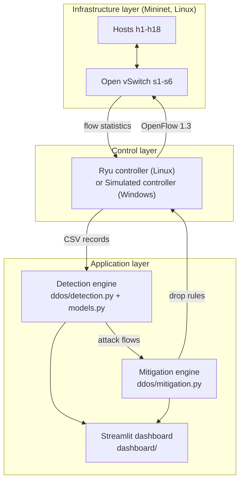

# DDoS Attack Detection and Mitigation using Machine Learning and SDN

A final-year engineering prototype. It reads network **flow statistics**, classifies each flow
as **Normal** or **DDoS** with machine learning, gives a verdict every **10 seconds**, and
**simulates** how a Software-Defined Networking (SDN) controller would block the attack.

> **Read this before quoting any result**
> - The real dataset (`FlowStatsfile.csv`) is **not** in this repository. The dashboard uses
>   **synthetic** sample data, whose classes are easy to separate. Scores near 100 % are
>   **not** real-world accuracy.
> - Mitigation is **simulated**. No packet is captured or blocked.
> - Mininet, Ryu and hping3 need Linux. They have **not** been run as part of this prototype.

## Quick start (Windows, PowerShell)

Run these in the project folder (the folder that contains this file).

```powershell
python -m venv venv                  # first time only
.\venv\Scripts\Activate.ps1          # if blocked: Set-ExecutionPolicy -Scope Process Bypass
pip install -r requirements.txt      # first time only
streamlit run dashboard\app.py       # opens on http://localhost:8501 ; stop with Ctrl + C
```

Run the command from the project folder so that the theme in `.streamlit/config.toml` is used.

## Dashboard pages

| Page | What you can do |
|---|---|
| Overview Dashboard | Totals, traffic distribution, detection timeline, attack periods |
| Live DDoS Detection | Pick a 10-second window; see verdict, model confidence, victim, sources and flows |
| Machine Learning Models | Compare five models; confusion matrix; feature importance; download model |
| Network Traffic Dataset | Upload CSV files, validate, handle missing values, preview, download |
| Attack Mitigation | Install simulated drop rules, replay the timeline, view the event log |
| About Project | Introduction, architecture, workflow, methodology, limitations |

## Using your own dataset

1. Open **Network Traffic Dataset -> Upload CSV**.
2. Choose **Training data** and upload a labelled `FlowStatsfile.csv`
   (22 columns, `label`: **0 = normal, 1 = DDoS**).
3. Optionally choose **Monitoring data** and upload a different file to detect attacks in.

The column list and an empty template are under the **Columns and samples** tab.
Uploads are limited to 1 GB. A synthetic file with 2.67 million rows (473 MB) took about
20 s to check and 65 s to train and classify on a PC with 8 GB RAM.

> The original README said `1 = legitimate`. The collector code writes **1 for attack** and
> 0 for benign traffic, and this project follows the code.

## Command line

```powershell
python -m ddos sample  --out data                      # write synthetic CSV files
python -m ddos train   --data data\synthetic_FlowStatsfile.csv --out models\random_forest.joblib
python -m ddos predict --model models\random_forest.joblib --data data\synthetic_monitor.csv
python -m unittest discover -s tests -t .              # run the tests
```

## System architecture



In the current prototype the dashboard reads CSV files (synthetic or uploaded) and talks to the
**simulated** controller only. The Linux path in the diagram is the original lab design.

## Project structure

```
.
├── dashboard/            Streamlit user interface
│   ├── app.py            entry point and navigation
│   ├── state.py          session state and caching
│   ├── ui.py             styles, charts, window selector
│   └── views/            one file per page
├── ddos/                 engine (no Streamlit code)
│   ├── schema.py         columns, features, constants
│   ├── sample_data.py    synthetic data
│   ├── preprocessing.py  CSV validation and cleaning
│   ├── models.py         training, evaluation, saving
│   ├── detection.py      10-second window verdicts
│   ├── mitigation.py     drop rules, replay, event log
│   ├── sdn.py            controller interface (simulated)
│   └── __main__.py       command line tools
├── Codes/                original project code (Ryu controller, Mininet, ML scripts)
├── tests/                automated tests
├── docs/                 report, viva questions, demo guide, original README
├── .streamlit/           theme and server settings
└── requirements.txt
```

## Documentation

- [Project report](docs/PROJECT_REPORT.md) - abstract to conclusion, with diagrams and results
- [Demonstration guide](docs/DEMO_GUIDE.md)
- [Viva questions and answers](docs/VIVA_QUESTIONS.md)
- [Windows and Linux setup](SETUP_WINDOWS.md) and [run guide](RUN_GUIDE.md)
- [Original README](docs/ORIGINAL_README.md)

## Credits and licence

Based on the open-source project
[DDoS-Attack-Detection-and-Mitigation](https://github.com/chiragbiradar/DDoS-Attack-Detection-and-Mitigation)
by Chirag Biradar. Contributors listed upstream:
[Akash Kumar](https://github.com/AkaskumarAK), [Apoorv Bagal](https://github.com/ApoorvBagal),
[Abhishek Ray](https://github.com/7abhishe). The Ryu, Mininet and original ML code in `Codes/`
comes from that project. See [LICENSE](LICENSE).
