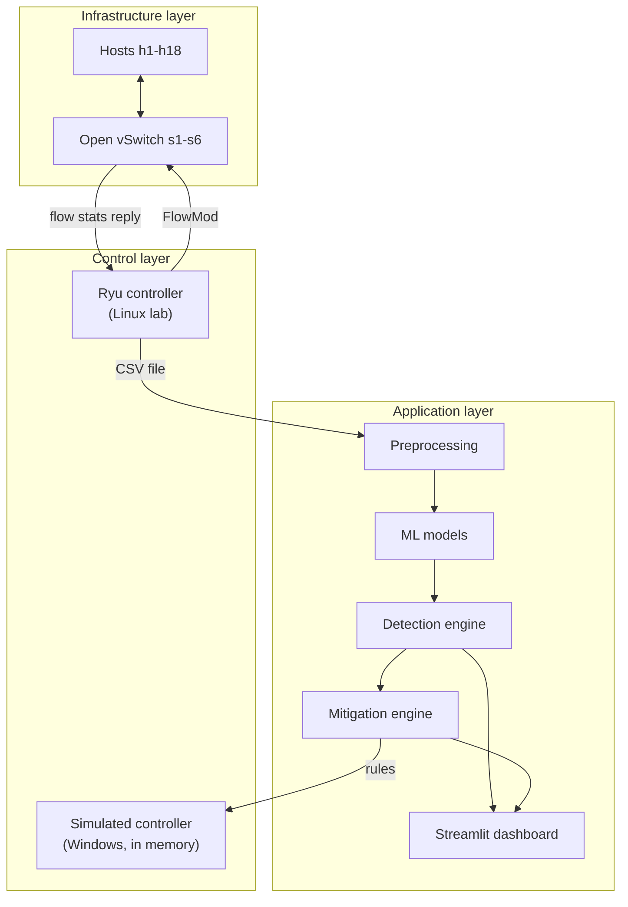
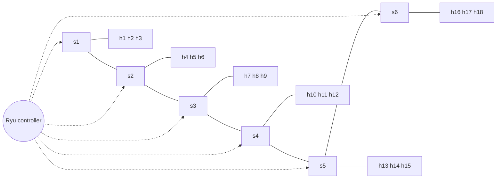
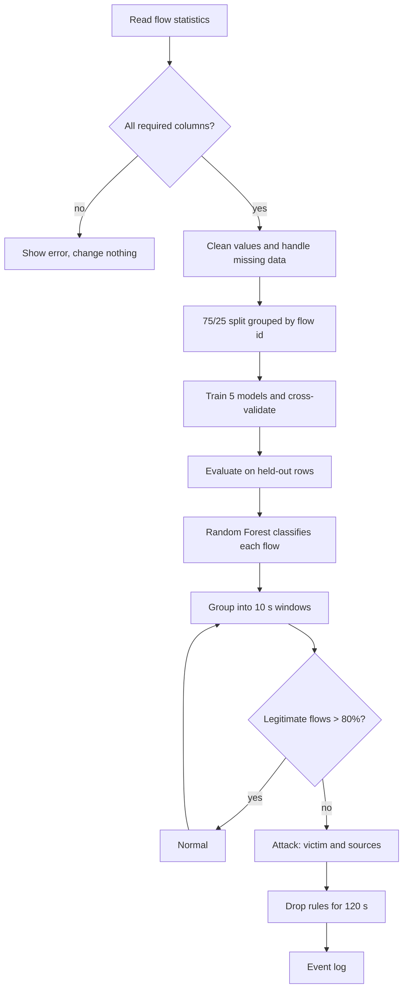

# Project Report

**Title:** DDoS Attack Detection and Mitigation Using Machine Learning and Software-Defined
Networking (SDN)

Contents: [1 Abstract](#1-abstract) · [2 Introduction](#2-introduction) ·
[3 Problem statement](#3-problem-statement) · [4 Objectives](#4-objectives) ·
[5 Existing system](#5-existing-system) · [6 Proposed system](#6-proposed-system) ·
[7 Architecture](#7-system-architecture) · [8 Methodology](#8-methodology) ·
[9 Requirements](#9-software-and-hardware-requirements) · [10 Implementation](#10-implementation) ·
[11 Results](#11-results) · [12 Advantages](#12-advantages) · [13 Limitations](#13-limitations) ·
[14 Future enhancements](#14-future-enhancements) · [15 Conclusion](#15-conclusion) ·
[16 How to execute](#16-how-to-execute-the-project)

---

## 1. Abstract

A Distributed Denial of Service (DDoS) attack sends so much traffic to a target that real users
cannot use it. Software-Defined Networking (SDN) gives one central controller a view of the
whole network. This project uses flow statistics available to an SDN controller and machine
learning to separate normal flows from attack flows. Five models are compared, and Random
Forest is used for detection. Traffic is judged in 10-second windows. When an attack is found,
the system identifies the victim and sources and creates drop rules. The working prototype is a
Streamlit dashboard that runs on Windows with **synthetic sample data** and a **simulated** SDN
controller. The original Ryu and Mininet code for a Linux lab is included but has not been
verified as part of this prototype.

## 2. Introduction

A **Denial of Service** attack tries to make a service unavailable. In a **distributed** attack
the traffic comes from many machines, often infected ones, so blocking one machine is not
enough. Common flood types are:

| Attack | How it works |
|---|---|
| ICMP flood | Huge number of ping messages |
| UDP flood | Huge number of UDP packets to the target |
| TCP SYN flood | Many connection requests that are never completed |
| LAND attack | Packets whose source address equals the destination address |

**SDN** separates the *control plane* (deciding) from the *data plane* (forwarding). Switches
report counters to the controller and follow the rules it sends, using the **OpenFlow**
protocol. This makes SDN a good place to detect and stop attacks. The controller itself is also
a target, which makes fast detection important.

## 3. Problem statement

Design a system that, from the flow statistics of an SDN network, can

1. decide for each flow whether it is normal or part of a DDoS attack,
2. raise an alarm quickly and identify the victim, and
3. propose a response that stops attack traffic while disturbing normal users as little as
   possible.

## 4. Objectives

1. Provide an SDN test topology (Mininet) and a controller application (Ryu).
2. Collect flow statistics for benign and attack traffic.
3. Prepare the data without data leakage.
4. Train and compare five machine learning models.
5. Detect attacks per 10-second window.
6. Simulate mitigation and record every action.
7. Provide a beginner-friendly dashboard.

## 5. Existing system

Common defences are firewalls, access lists, rate limiting, signature-based intrusion
detection and provider-side scrubbing services.

Drawbacks:
- Rules and thresholds are written by hand and become outdated.
- Each device sees only its own traffic.
- Signature systems miss new patterns.
- Changing rules on many devices is slow.

The starting point of this project was a set of command-line scripts: a Ryu controller that
trains a Random Forest at start-up, collectors that write CSV files, and Mininet traffic
scripts. It had no graphical interface, it used identifiers such as time and IP address as
model inputs, and it reported the victim host from the wrong row of the data.

## 6. Proposed system

- A central SDN controller supplies flow statistics.
- A cleaning step validates every record.
- Machine learning classifies flows using only behaviour features.
- A window rule turns flow decisions into an attack alarm.
- A mitigation engine creates temporary drop rules through a controller interface.
- A dashboard shows traffic, model quality, data and actions.

### Changes made to the original approach

| Original | Now | Reason |
|---|---|---|
| Time, IPs and flow id used as features | Removed | They reveal the lab setup, not attack behaviour |
| Random row split | Split grouped by flow id | The same flow must not be in both train and test |
| Accuracy only | Accuracy, precision, recall, F1, confusion matrix, cross-validation | Accuracy alone can mislead |
| Victim read using the predicted label as row number | Row of the flagged flow | Bug fix in the `Codes` controllers |
| Command line only | Six-page dashboard | Easier to understand and demonstrate |

## 7. System architecture



**What runs in this prototype:** CSV file or synthetic data -> preprocessing -> models ->
detection -> mitigation -> *simulated* controller -> dashboard.
**What is only in the original Linux code:** Mininet, switches, Ryu and live blocking. The
dashboard and the Ryu controller are **not connected** to each other.

### Network topology (`Codes/mininet/topology.py`)



## 8. Methodology

### Workflow



### 8.1 Data

One row describes one flow at one polling time. `FlowStatsfile.csv` has 22 columns:
`timestamp, datapath_id, flow_id, ip_src, tp_src, ip_dst, tp_dst, ip_proto, icmp_code,
icmp_type, flow_duration_sec, flow_duration_nsec, idle_timeout, hard_timeout, flags,
packet_count, byte_count, packet_count_per_second, packet_count_per_nsecond,
byte_count_per_second, byte_count_per_nsecond, label`.
The label is **0 = normal, 1 = DDoS**.

### 8.2 Cleaning rules

| Situation | Action |
|---|---|
| Required column missing | File rejected, column names listed |
| Text where a number is expected, infinity, impossible negative value | Treated as missing |
| Invalid IPv4 address | Treated as missing |
| Missing time, switch, flow id, address or protocol | Row removed (cannot be estimated) |
| Missing or invalid label | Row removed (labels are never invented) |
| Missing feature value | User chooses: remove row, or fill with the training median |

### 8.3 Features

Used (11): `ip_proto, icmp_code, icmp_type, flow_duration_sec, idle_timeout, hard_timeout,
flags, packet_count, byte_count, packet_count_per_second, byte_count_per_second`.

Left out: `timestamp` (benign and attack data are collected at different times, so it leaks the
label), `datapath_id, flow_id, ip_src, ip_dst, tp_src, tp_dst` (identifiers),
`flow_duration_nsec` and the two per-nanosecond rates (noise).

### 8.4 Preventing data leakage

- Identifiers are not features.
- All rows of one flow id stay on one side of the split. If the data has too few flows for
  this, a row split is used and the dashboard shows a warning.
- Median filling and scaling are inside a scikit-learn `Pipeline`, so they learn from
  training rows only.
- The best model is chosen by 3-fold cross-validation on the training rows.
- A fixed random seed makes results repeatable.

### 8.5 Models

| Model | Idea |
|---|---|
| Random Forest (primary) | Many decision trees vote; 10 trees, entropy criterion |
| Decision Tree | A sequence of yes/no questions |
| Logistic Regression | Weighted sum turned into a probability |
| K-Nearest Neighbors | Majority class of the 5 closest examples |
| Support Vector Machine | Boundary with the widest margin (RBF kernel) |

### 8.6 Measures

With TP (attack found), TN (normal passed), FP (false alarm), FN (missed attack):

- Accuracy = (TP + TN) / all
- Precision = TP / (TP + FP)
- Recall = TP / (TP + FN)
- F1 = 2 x Precision x Recall / (Precision + Recall)
- False alarm rate = FP / (FP + TN)

### 8.7 Detection and mitigation

A window is an **attack** when 80 % or less of its flows are predicted normal (the rule in
`controller.py`). The victim is the destination with the most flagged flows.
For each (switch, source, destination, protocol) of the flagged flows a rule with priority 100,
empty action list (drop) and a 120-second hard timeout is created. In the simulator a rule
installed after window *w* applies to windows *w+1* to *w+12*.

The original `mitigation_module.py` uses a different method: it blocks the switch **port** from
which a source address arrives that was never seen in ARP on that port. The CSV files do not
contain port or ARP data, so the dashboard cannot simulate that method.

The **model confidence** shown in the dashboard is the average vote of the Random Forest trees. It is
not a calibrated probability.

## 9. Software and hardware requirements

### Dashboard (Windows)

| Item | Requirement |
|---|---|
| Operating system | Windows 10 / 11 |
| Python | 3.14.2 (tested) |
| Libraries | pandas 3.1.1, NumPy 2.5.5, scikit-learn 1.9.1, joblib 1.6.0, Streamlit 1.67.0, Plotly 7.1.0, Matplotlib 3.11.2 |
| Browser | Chrome or Edge |
| Hardware | Tested with 8 GB RAM (server peak about 3 GB with a 2.67-million-row file); 1 GB free disk |

### SDN lab (optional, not verified here)

| Item | Requirement |
|---|---|
| Operating system | Ubuntu in WSL2 or a virtual machine |
| Tools | Mininet, Open vSwitch, hping3, Ryu (older Python, 3.8-3.9), pandas, scikit-learn |

## 10. Implementation

| Module | File | Responsibility |
|---|---|---|
| Schema | `ddos/schema.py` | Column names, features, constants |
| Sample data | `ddos/sample_data.py` | Synthetic training set and 10-minute timeline |
| Preprocessing | `ddos/preprocessing.py` | Reading, validation, cleaning |
| Models | `ddos/models.py` | Split, training, metrics, saving and loading |
| Detection | `ddos/detection.py` | Flow scores, window verdicts, victim |
| Mitigation | `ddos/mitigation.py` | Rules, expiry, replay, event log |
| SDN interface | `ddos/sdn.py` | `SDNController` base class, `SimulatedController`, message formats |
| Command line | `ddos/__main__.py` | `sample`, `train`, `predict` |
| Dashboard | `dashboard/` | Six pages |
| Tests | `tests/` | Engine and page tests |

### Adding a real controller later

Create a class that inherits `SDNController` and implements `install_rule`, `remove_rule` and
`list_rules`. `to_ryu_flow_entry()` already builds the message format of Ryu's `ofctl_rest`
API. Set `is_live = True` only after the switch confirms rules, then pass the object to
`MitigationEngine`. This step is **future work**: nothing is sent over a network today. The
dashboard text that says "simulation" must be updated at the same time.

## 11. Results

> **All results in this section come from SYNTHETIC data** (seed 0). Normal flows have 5-60
> packets and attack flows 520-19,988 packets, so the classes do not overlap. High scores show
> that the software works. They do **not** show how accurate it would be on a real network.

### 11.1 Model comparison (3,000 training rows, 1,000 held-out test rows)

| Model | Accuracy | Precision | Recall | F1 | CV F1 |
|---|---|---|---|---|---|
| Random Forest | 100.00 % | 100.00 % | 100.00 % | 100.00 % | 100.00 % |
| Decision Tree | 100.00 % | 100.00 % | 100.00 % | 100.00 % | 100.00 % |
| K-Nearest Neighbors | 99.80 % | 100.00 % | 99.61 % | 99.80 % | 99.44 % |
| Logistic Regression | 98.90 % | 100.00 % | 97.83 % | 98.91 % | 98.30 % |
| Support Vector Machine | 98.70 % | 100.00 % | 97.44 % | 98.70 % | 98.23 % |

Random Forest confusion matrix: 492 true normal, 508 true attack, 0 false alarms, 0 misses.
Random Forest and Decision Tree are tied; Random Forest is kept as the primary model.

### 11.2 Detection on the 10-minute timeline (6,000 flows, 60 windows)

| Item | Result |
|---|---|
| Window 25 (default) | 109 flows, 17 % legitimate -> **attack**, victim h1 |
| Window 5 | 107 flows, 96 % legitimate -> **normal** |
| Flows flagged as DDoS | 1,569 |
| Attack windows | 20 to 35 (16 windows) |
| Window verdicts agreeing with the synthetic labels | 60 of 60 |

The burst is planned for windows 20-34. Because arrival times are random, 62 of the 114 flows
in window 35 are also attack flows, so window 35 is correctly reported as an attack.

### 11.3 Simulated mitigation

| Case | Result |
|---|---|
| Rules installed for window 25 | 76 rules; 194 flows matched in the next 120 s (193 attack, 1 normal) |
| Automatic replay of the whole timeline | 378 rule installations; 57.3 % of all packets matched |
| Attack flows matched in the replay | 924 of 1,569 (59 %) |
| Normal flows matched in the replay (collateral damage) | 31 of 4,431 |

Many attack flows are not matched because a rule exists only after a flow group has been seen
once. Source-based rules react to the past.

### 11.4 Testing

| Test | Method | Result |
|---|---|---|
| Engine and page tests | `python -m unittest` (39 tests) | Passed |
| Browser test: pages, uploads, invalid files, downloads, mitigation, phone width | Chrome, 48 checks | Passed |
| Large synthetic file (2.67 million rows, 473 MB) | Browser upload, 8 GB RAM PC | Passed |
| Original `Codes` ML scripts on synthetic CSV | Run on Windows | Ran without errors |
| Original controller victim fix | Run with stand-ins for Ryu | Correct host reported |
| Ryu controller, Mininet, hping3 | - | **Not tested** |
| Real dataset | - | **Not tested** (not available) |

## 12. Advantages

- Network-wide view through SDN.
- Learns from data instead of fixed packet thresholds.
- Careful evaluation that avoids obvious data leakage.
- Safe to demonstrate: nothing touches a real network.
- Works on an ordinary Windows laptop.
- Detection, mitigation and controller are separate, so each can be replaced.

## 13. Limitations

- No real dataset; sample data is synthetic and easy to classify.
- Mitigation is simulated, and the dashboard is not connected to Ryu.
- Recorded files are replayed; there is no live packet or flow capture.
- Two classes only; the attack type is not identified.
- A window verdict needs a high *share* of attack flows. An attack hidden in a lot of normal
  traffic, or a slow attack, can be missed.
- Drop rules by source address do not stop randomly spoofed sources.
- Flow counters in OpenFlow grow over the life of a flow, so repeated polls are related.
- The original Ryu controller still uses all columns, including identifiers, and hides errors
  inside a bare `except`. Only the victim bug was fixed there.
- `Codes/mininet/generate_ddos_trafic.py` uses the Python 2 web server module.

## 14. Future enhancements

1. Collect a real dataset in the Mininet lab and report results on it.
2. Test across collection sessions (train on one day, test on another).
3. Implement a live Ryu controller behind `SDNController`.
4. Use the same feature set in the Ryu controller as in the dashboard.
5. Add multi-class detection of ICMP, UDP, SYN and LAND attacks.
6. Add entropy features and rate limiting.
7. Store events in a database and send alerts.

## 15. Conclusion

The project turns a set of command-line scripts into a usable prototype for studying DDoS
detection in SDN. It validates flow data, compares five models fairly, detects attack windows,
and shows the effect of temporary drop rules in a safe simulation. On synthetic data every part
of the pipeline behaves as designed. Claims about real-world accuracy and real blocking remain
open until a real dataset is collected and a live controller is built and tested.

## 16. How to execute the project

```powershell
cd <project folder>
python -m venv venv                  # first time only
.\venv\Scripts\Activate.ps1
pip install -r requirements.txt      # first time only
streamlit run dashboard\app.py       # http://localhost:8501
python -m unittest discover -s tests -t .
```

For the Linux SDN lab see [SETUP_WINDOWS.md](../SETUP_WINDOWS.md). For the presentation see
[DEMO_GUIDE.md](DEMO_GUIDE.md).
